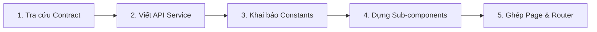

# 🍽️ T-ResMK Restaurant — Frontend Developer Guide

> Hướng dẫn kỹ thuật dành cho lập trình viên (Developers / Tech Lead) để khởi chạy, phát triển tính năng mới, kiểm thử và debug dự án Frontend Nhà hàng T-ResMK.

---

## ⚡ 1. Khởi Chạy Nhanh (Quick Start)

### Yêu cầu môi trường:
- **Node.js:** `>= 18.x` (khuyến nghị Node 20+ LTS)
- **Package Manager:** `npm` (kèm theo Node.js)
- **Backend API:** Laravel 11 chạy tại `http://localhost:8000` (hoặc cấu hình qua `.env`)

### Cài đặt và chạy:
```bash
# 1. Cài đặt các gói thư viện
npm install

# 2. Tạo file cấu hình môi trường từ mẫu (nếu chưa có)
cp .env.example .env

# 3. Khởi động môi trường phát triển (Dev Server)
npm run dev
# -> Local: http://localhost:5173/

# 4. Kiểm tra biên dịch bản phát hành (Production Build Check)
npm run build
```

### Cấu hình biến môi trường (`.env`):
```env
# URL gốc của RESTful API Backend
VITE_API_BASE_URL=http://localhost:8000/api/v1
```

---

## 🛠️ 2. Bảng Tech Stack & Thư Viện Cốt Lõi

| Nhóm kỹ thuật | Thư viện & Phiên bản | Vai trò & Điểm nổi bật |
|:---|:---|:---|
| **Core Framework** | `React 19.3.1` | React thế hệ mới tích hợp sẵn `React Compiler` (`babel-plugin-react-compiler`) tối ưu re-render tự động. |
| **Build Tool** | `Vite 8.3.4` | Tốc độ biên dịch cực nhanh, hỗ trợ Hot Module Replacement (HMR) tức thì. |
| **Styling** | `Tailwind CSS v4.3.3` | Zero-runtime CSS engine thế hệ mới tích hợp qua `@tailwindcss/vite`, thiết kế theme tối (Dark Luxury). |
| **Routing** | `React Router v7.18.4` | Quản lý điều hướng Single Page Application (SPA), bảo vệ phân quyền Route (`AdminRoute`). |
| **Networking** | `Axios 1.20.0` | Centralized HTTP Client với Interceptors tự động nạp Sanctum Bearer Token và xử lý lỗi tập trung. |
| **Iconography** | `Lucide React 1.59.0` | Bộ icons SVG hiện đại, tree-shakable giúp giảm thiểu bundle size. |

---

## 📁 3. Cấu Trúc Thư Mục Cấp Cao (High-Level Architecture)

Dự án được tổ chức theo **Kiến trúc hướng tính năng (Modular Feature-based Architecture)**:

```text
restaurant/fe/
├── docs/                             # 📖 Toàn bộ tài liệu đặc tả hệ thống
│   ├── api/                          # Hợp đồng API từng phân hệ (Request/Response JSON chuẩn)
│   │   └── api-matrix-cheatsheet.md  # Bảng tra cứu chéo 63 APIs <-> Service JS
│   ├── modules/                      # 8 Bounded Contexts chi tiết từ Backend v2.0
│   ├── api_protocol_specification.md # Chuẩn ApiResponse Envelope & HTTP Codes
│   └── system_conventions.md         # Bảng 7 Backed Enums chuẩn hệ thống
├── public/                           # Tài nguyên tĩnh không qua bundling (ảnh món ăn mẫu, logos)
└── src/
    ├── assets/                       # Ảnh, fonts và styles tĩnh phục vụ giao diện
    ├── components/
    │   └── ui/                       # 🧱 Base UI components tái sử dụng (Button, Input, Modal, Pagination, Alert, Skeleton)
    ├── contexts/                     # 🌐 Global State quản lý qua React Context API
    │   ├── AuthContext.jsx           # Quản lý phiên đăng nhập, thông tin user, vai trò (RBAC)
    │   └── CartContext.jsx           # Quản lý giỏ hàng, số lượng và tổng tiền tạm tính
    ├── features/                     # 🚀 Các miền nghiệp vụ độc lập (Feature Modules)
    │   ├── auth/                     # Đăng ký, đăng nhập, bảo vệ token Sanctum
    │   ├── customer/                 # Phân hệ Khách hàng (Menu, Giỏ hàng, Checkout QR, Đặt bàn, Hồ sơ, Gợi ý Neo4j)
    │   │   ├── cart/                 # Quản lý giỏ hàng và danh sách món đã chọn
    │   │   ├── menu/                 # Thực đơn, bộ lọc Meilisearch, thời tiết & gợi ý Neo4j
    │   │   ├── order/                # Checkout đơn hàng, lịch sử và trang hiển thị VietQR
    │   │   ├── profile/              # Thông tin cá nhân, sổ địa chỉ và cảnh báo dị ứng
    │   │   └── reservation/          # Tìm bàn trống và tạo phiếu đặt bàn
    │   └── admin/                    # Phân hệ Quản trị viên (Layout, Dashboard, Món, Bàn, Đơn, Tài khoản)
    │       ├── account/              # Phân trang người dùng, khóa/mở khóa tài khoản
    │       ├── dashboard/            # Báo cáo doanh thu và 4 nhóm chỉ số vận hành
    │       ├── dish/                 # CRUD món ăn (xóa mềm), danh mục và chọn ảnh
    │       ├── layout/               # AdminLayout, AdminSidebar, Header và Guard route
    │       ├── order/                # Quản lý đơn hàng (FSM 5 bước) & giao dịch thanh toán
    │       └── table/                # Sơ đồ trạng thái bàn (8 bàn) và điều phối đặt bàn
    ├── lib/
    │   └── axios.js                  # 🔌 Cấu hình Axios Client & Interceptors tập trung
    ├── App.jsx                       # 🧭 Khai báo cây định tuyến (Router Registry) toàn ứng dụng
    └── main.jsx                      # Entry point khởi tạo ứng dụng React với DOM
```

---

## 🚦 4. Quy Trình Lập Trình (Bắt Đầu Từ Đâu Khi Code Tính Năng Mới?)

Khi nhận bất kỳ yêu cầu tạo màn hình hoặc thêm chức năng mới, hãy tuân thủ quy trình 5 bước:



1. **Bước 1 — Tra cứu Hợp đồng API:**
   - Mở [docs/api/api-matrix-cheatsheet.md](./docs/api/api-matrix-cheatsheet.md) để xác định mã Use Case (`ORD-01`, `BKG-02`...), Endpoint URL, Body Request và Response Payload.
2. **Bước 2 — Viết hàm Service:**
   - Tạo hoặc bổ sung hàm gọi API trong `src/features/<domain>/<module>/services/<name>Service.js`.
   - Sử dụng instance `apiClient` từ `src/lib/axios.js`.
3. **Bước 3 — Định nghĩa Constants & Enums:**
   - Nếu có trạng thái mới, khai báo trong file `constants.js` cùng thư mục feature.
   - **Bắt buộc:** Enum dùng tiếng Anh viết hoa (Ví dụ: `ACTIVE`, `LOCKED`, `CONFIRMED`, `MAINTENANCE`).
4. **Bước 4 — Dựng Sub-components (< 200 dòng):**
   - Không dồn toàn bộ code vào 1 Page. Tách thành: `FilterBar`, `Table`, `Modal`, `Card`.
   - **Bắt buộc 4 trạng thái UI:** `Loading` (Skeleton), `Error` (kèm nút Thử lại), `Empty` (thông báo trống + CTA), `Data/Success`.
5. **Bước 5 — Ghép Page & Đăng ký Route:**
   - Ghép các sub-components vào `Page.jsx` để điều phối State.
   - Đăng ký Route vào [src/App.jsx](./src/App.jsx) (Nếu là route Admin, bọc bên trong `<AdminRoute><AdminLayout /></AdminRoute>`).

---

## 🔍 5. Các Lưu Ý Kỹ Thuật Quan Trọng Khi Code & Debug

### 5.1. Cơ chế bóc tách Envelope của Axios (`src/lib/axios.js`)
Backend Laravel luôn bọc kết quả trong envelope chuẩn:
```json
{ "success": true, "code": 200, "message": "...", "data": { ... } }
```
> ⚠️ **Đặc biệt lưu ý:** Axios Response Interceptor trong `src/lib/axios.js` đã tự động bóc tách tầng `response.data`. Do đó khi gọi service:
```javascript
// Dữ liệu thực tế nhận được từ Service:
const res = await getDishesApi(params)

// Bóc tách phòng thủ kép an toàn cho cả mảng và phân trang:
const items = res?.data?.items || res?.data || []
const pagination = res?.data?.pagination || { currentPage: 1, lastPage: 1, totalItems: 0 }
```

### 5.2. Quản lý Phiên & Token Sanctum
- Token được lưu trữ tại `STORAGE_KEYS.ACCESS_TOKEN` (`auth_token`).
- Request Interceptor tự động gắn `Authorization: Bearer <token>` cho mọi request (ngoại trừ `/auth/login` và `/auth/register`).
- Khi Backend trả về lỗi `401 Unauthorized` (Token hết hạn hoặc tài khoản bị Admin khóa `LOCKED`), interceptor sẽ tự động xóa sạch storage và yêu cầu người dùng đăng nhập lại.

### 5.3. Xử lý Trạng thái Bàn ăn & Đặt bàn
- Hệ thống hỗ trợ 4 trạng thái bàn: `AVAILABLE` (Trống), `RESERVED` (Đã đặt trước), `OCCUPIED` (Đang sử dụng), `MAINTENANCE` (Đang bảo trì).
- Khi điều phối đặt bàn: Chuyển khách vào bàn bằng `SEATED` $\rightarrow$ Bàn tự động chuyển sang `OCCUPIED`.

### 5.4. Động cơ Gợi ý Món Neo4j & VietQR
- **Neo4j Graph AI:** Gọi qua `recommendationService.js` (`/dishes/{id}/recommendations/graph` và `/recommendations/personalized`). Luôn có fallback tự động nếu Neo4j offline.
- **VietQR:** Hiển thị ảnh QR theo cú pháp `https://img.vietqr.io/image/{bankBin}-{accountNo}-compact2.png?...&addInfo=DH{orderId}%20THANH%20TOAN`. Trang Checkout tiến hành polling mỗi 3-5s qua `PAY-06` để phát hiện biến động số dư.

---

## 🧪 6. Scripts Lệnh Thường Dùng

```bash
# Chạy môi trường phát triển (Hot Reload)
npm run dev

# Kiểm tra chất lượng mã nguồn qua ESLint
npm run lint

# Biên dịch kiểm tra lỗi cú pháp và đóng gói Production
npm run build

# Chạy thử bản build production trên môi trường local
npm run preview
```
