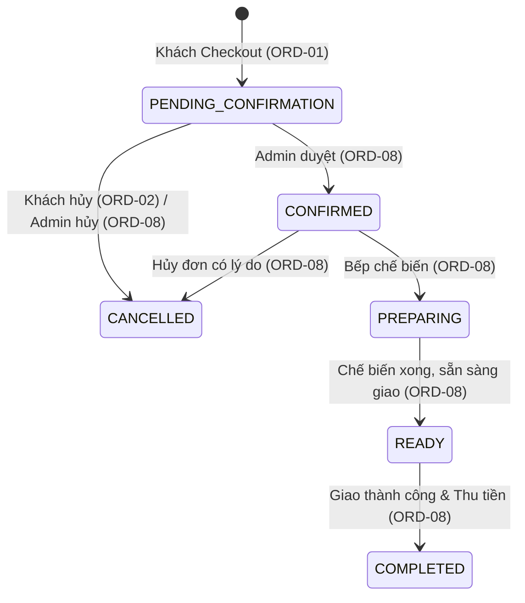

# ENUMS & STATUS VALUES (Hệ Thống Nhà Hàng Lumière)

> 📌 **Tài liệu gốc Backend:** [system_conventions.md](../system_conventions.md)  
> Tất cả Enum/Status trong hệ thống **BẮT BUỘC** dùng tiếng Anh IN HOA khi giao tiếp qua RESTful API.  
> Frontend và Backend đều ánh xạ 1-1 với các Backed Enums chuẩn dưới đây.

---

## 1. RoleType (Vai Trò Hệ Thống)
| Enum Value (API) | `ma_vai_tro` (DB) | Tên vai trò | Ý nghĩa & Quyền hạn |
|:---|:---:|:---|:---|
| `ADMIN` | 1 | Quản trị viên | Toàn quyền cấu hình, quản lý thực đơn, bàn ăn, tài khoản, doanh thu |
| `STAFF` | 2 | Nhân viên phục vụ | Hỗ trợ điều phối đơn hàng và bàn ăn |
| `CUSTOMER` | 3 | Khách hàng | Đặt bàn, đặt món trực tuyến, quản lý giỏ hàng và hồ sơ cá nhân |

---

## 2. AccountStatus (Trạng Thái Tài Khoản)
| Enum Value (API) | Giá trị DB | Ý nghĩa | Hành vi hệ thống |
|:---|:---|:---|:---|
| `ACTIVE` | `Hoạt động` | Đang hoạt động | Đăng nhập và thao tác bình thường |
| `LOCKED` | `Bị khóa` | Đang bị khóa | Thu hồi toàn bộ Token Sanctum, chặn đăng nhập và thao tác (HTTP 403) |

---

## 3. OrderStatus (Trạng Thái Đơn Hàng) & FSM
> Chi tiết luồng chuyển trạng thái: [modules/order.md](../modules/order.md)

| Enum Value (API) | Giá trị DB | Ý nghĩa | Quyền chuyển |
|:---|:---|:---|:---|
| `PENDING_CONFIRMATION` | `Chờ xác nhận` | Chờ nhà hàng duyệt | Tự động khi checkout |
| `CONFIRMED` | `Đã xác nhận` | Đã duyệt đơn hàng | Admin duyệt |
| `PREPARING` | `Đang chuẩn bị` | Bếp đang nấu món | Admin chuyển |
| `READY` | `Sẵn sàng` | Đã nấu xong, sẵn sàng phục vụ | Admin chuyển |
| `COMPLETED` | `Hoàn thành` | Đơn hàng hoàn tất & Đã thanh toán | Admin chuyển *(Terminal state)* |
| `CANCELLED` | `Đã hủy` | Đơn hàng đã bị hủy | Khách hủy (khi PENDING) hoặc Admin *(Terminal state)* |

---

## 4. FulfillmentType (Hình Thức Nhận Hàng)
| Enum Value (API) | Ý nghĩa | Lưu ý |
|:---|:---|:---|
| `DELIVERY` | Giao hàng tận nơi | Yêu cầu nhập địa chỉ giao hàng đầy đủ |
| `DINE_IN` | Dùng bữa tại nhà hàng | Ăn tại chỗ theo đặt bàn |
| `TAKEAWAY` | Đến lấy mang đi | Tự đến nhận món tại quầy |

---

## 5. PaymentMethod & PaymentStatus (Thanh Toán)
> Chi tiết quy trình thanh toán VietQR & Đối soát: [modules/payment.md](../modules/payment.md)

### Phương thức thanh toán (PaymentMethod)
| Enum Value (API) | Giá trị DB | Ý nghĩa |
|:---|:---|:---|
| `BANK_TRANSFER_QR` | `Chuyển khoản QR` | Chuyển khoản ngân hàng qua mã VietQR Napas 247 |
| `CASH` | `Tiền mặt` | Thanh toán trực tiếp tại quầy / COD |

### Trạng thái thanh toán (PaymentStatus)
| Enum Value (API) | Giá trị DB | Ý nghĩa |
|:---|:---|:---|
| `UNPAID` | `Chưa thanh toán` | Đang chờ khách thanh toán |
| `PAID` | `Đã thanh toán` | Đã nhận đủ tiền (qua Webhook hoặc xác nhận tại quầy) |
| `REFUNDED` | `Đã hoàn tiền` | Đã hoàn trả tiền cho khách |
| `FAILED` | `Thất bại` | Giao dịch thất bại hoặc bị hủy |

---

## 6. TableStatus (Trạng Thái Bàn Ăn)
| Enum Value (API) | Giá trị DB | Ý nghĩa |
|:---|:---|:---|
| `AVAILABLE` | `Trống` | Bàn trống, sẵn sàng tiếp khách |
| `RESERVED` | `Đã đặt` | Bàn đã có khách đặt trước trong ca |
| `OCCUPIED` | `Đang sử dụng` | Khách đang ngồi dùng bữa tại bàn |
| `MAINTENANCE` | `Đang bảo trì` | Bàn đang bảo dưỡng, sửa chữa hoặc tạm ngừng phục vụ |

---

## 7. ReservationStatus (Trạng Thái Phiếu Đặt Bàn)
> Ma trận đồng bộ bàn ăn: [modules/reservation.md](../modules/reservation.md)

| Enum Value (API) | Giá trị DB | Ý nghĩa | Trạng thái Bàn tương ứng |
|:---|:---|:---|:---|
| `PENDING` | `Chờ xử lý` | Khách vừa gửi yêu cầu | Bàn giữ nguyên trạng thái cũ |
| `CONFIRMED` | `Đã xác nhận` | Admin duyệt phiếu | Bàn chuyển sang `RESERVED` |
| `SEATED` | `Đang dùng bữa` | Khách đã đến nhận bàn | Bàn chuyển sang `OCCUPIED` |
| `COMPLETED` | `Hoàn thành` | Khách thanh toán ra về | Bàn giải phóng về `AVAILABLE` |
| `CANCELLED` | `Đã hủy` | Khách hoặc Admin hủy | Bàn giải phóng về `AVAILABLE` |
| `REJECTED` | `Bị từ chối` | Nhà hàng từ chối đặt bàn | Bàn giải phóng về `AVAILABLE` |

---

## 8. WeatherCondition (Gợi Ý Món Ăn Theo Thời Tiết)
| Enum Value (API) | Nhóm thời tiết | Mô tả điều kiện OpenWeatherMap |
|:---|:---|:---|
| `HOT_SUNNY` | Nắng nóng | Nhiệt độ $\ge 30^\circ\text{C}$ hoặc trời quang nắng |
| `RAINY_OR_COLD` | Mưa hoặc se lạnh | Nhiệt độ $\le 22^\circ\text{C}$, có mưa hoặc dông bão |
| `PLEASANT_NORMAL` | Dễ chịu / Bình thường | Nhiệt độ $23^\circ\text{C} - 29^\circ\text{C}$, trời mát mẻ |

---

## 9. Allergens & DietaryPreferences (Hồ Sơ Sức Khỏe & Dinh Dưỡng)

### Chất gây dị ứng (Allergens)
- `PEANUT` (Đậu phộng)
- `SHELLFISH` (Hải sản có vỏ: tôm, cua, ốc)
- `DAIRY` (Sữa & chế phẩm từ sữa)
- `EGG` (Trứng)
- `GLUTEN` (Gluten / Lúa mì)
- `SOY` (Đậu nành)

### Sở thích dinh dưỡng (DietaryPreferences)
- `LOW_SUGAR` (Ít đường)
- `HIGH_PROTEIN` (Giàu chất đạm)
- `VEGETARIAN` (Ăn chay)
- `LOW_CARB` (Ít tinh bột)
