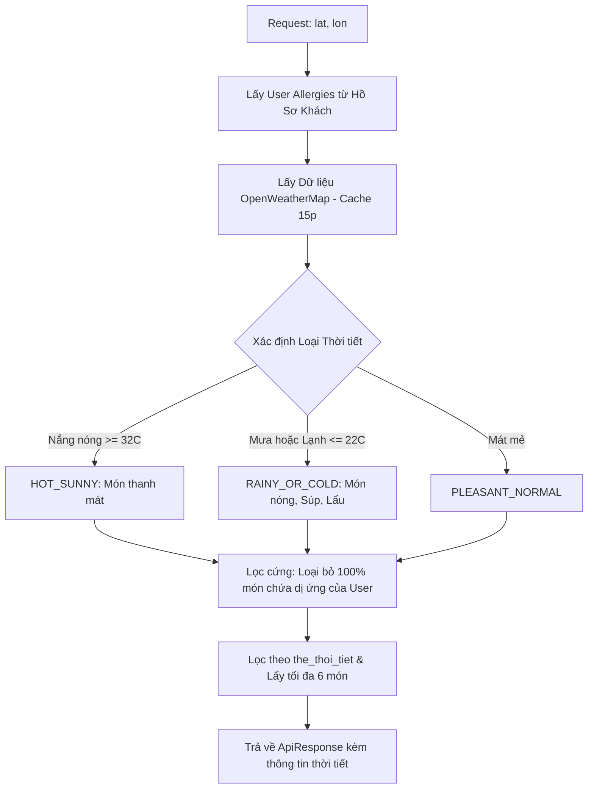

# 🥗 MODULE: MENU – Business Logic & API Spec

> **Vị trí thư mục:** `app/Modules/Menu/`  
> **Namespace:** `App\Modules\Menu\`  
> **Phiên bản:** 2.0 (Streamlined Edition)

---

## 1. Tổng quan & Trách nhiệm

Module **Menu** là trung tâm quản lý thực đơn của hệ thống nhà hàng:
- **Phía Khách hàng:** Lấy danh sách danh mục (Redis Cache), duyệt và tìm kiếm món ăn phân trang (kết hợp động cơ **Meilisearch** chịu lỗi chính tả và tìm không dấu, bộ lọc giá, dị ứng, danh mục), xem chi tiết món, nhận gợi ý món ăn theo thời tiết thực tế (OpenWeatherMap + lọc dị ứng).
- **Phía Quản trị:** Quản lý CRUD Danh mục và Món ăn, ẩn/hiện, xóa mềm bảo toàn toàn vẹn đơn hàng và cơ chế xóa bộ nhớ đệm tự động (Cache Busting).

---

## 2. Thành phần kỹ thuật

| Thành phần | Lớp / Đường dẫn thực tế | Trách nhiệm |
| :--- | :--- | :--- |
| **Models** | `Category` (`DANH_MUC`)<br>`Dish` (`MON_AN`) | Danh mục món ăn và chi tiết món ăn (tích hợp trait `Laravel\Scout\Searchable`, schema `toSearchableArray()`, index `dishes`). |
| **Services** | `Customer\MenuService`<br>`Admin\CategoryService`<br>`Admin\DishService` | Truy vấn thực đơn, tìm kiếm Meilisearch kèm Fallback MySQL `LIKE`, lọc thời tiết, CRUD danh mục/món ăn, xóa mềm và Cache Busting. |
| **Controllers** | `Customer\MenuController`<br>`Admin\CategoryController`<br>`Admin\DishController` | Tiếp nhận request và trả về chuẩn `ApiResponse`. |
| **FormRequests** | `Customer\WeatherRecommendationRequest`<br>`Admin\CreateCategoryRequest`<br>`Admin\CreateDishRequest`, `UpdateDishRequest`... | Kiểm thực dữ liệu đầu vào. |
| **Resources** | `CategoryResource`, `AdminCategoryResource`<br>`DishResource`, `DishDetailResource`, `AdminDishResource` | Chuẩn hóa dữ liệu JSON đầu ra cho Frontend. |
| **Routes** | `app/Modules/Menu/Routes/api.php` | Định tuyến `/api/v1/customer/*` và `/api/v1/admin/*`. |

---

## 3. Domain Rules Bất Biến

### 3.1. Chiến Lược Cache Redis & Cache Busting
- `menu:categories:active` (TTL 3600s): Danh sách danh mục đang bán. Admin thay đổi danh mục (`MNU-09`, `10`, `11`, `12`) $\rightarrow$ Gọi `Cache::forget('menu:categories:active')`.
- `weather_rec_{lat}_{lon}_{accountId}` (TTL 900s): Gợi ý món theo thời tiết. Tự hết hạn sau 15 phút.

### 3.2. Quy Tắc Xóa Mềm Món Ăn & Danh Mục
- **TUYỆT ĐỐI KHÔNG** gọi lệnh xóa vật lý `$dish->delete()`. Vi phạm ràng buộc khóa ngoại trong `CHI_TIET_DON_HANG`.
- **Luật Xóa mềm:** Luôn cập nhật cờ `$dish->update(['da_xoa' => true, 'hien_thi' => false])`.
- Khi xóa mềm danh mục: Tự động ẩn toàn bộ món thuộc danh mục đó.

### 3.3. Động Cơ Tìm Kiếm Meilisearch (Typo-Tolerance & Graceful Fallback)
- **Động cơ tìm kiếm:** `Dish::search($keyword)` qua Meilisearch 1.7 (Port 7700) sử dụng Laravel Scout.
- **Typo-Tolerance:** Cấu hình `minWordSizeForTypos: { oneTypo: 3, twoTypos: 7 }` hỗ trợ tìm kiếm chịu lỗi chính tả (gõ `tra daoo` $\rightarrow$ ra `Trà đào cam sả`, `phoo bo` $\rightarrow$ ra `Phở bò đặc biệt`) và tiếng Việt không dấu (`com tam`, `che khuc bach`).
- **Graceful Fallback:** Được bọc trong khối `try ... catch (\Throwable $e)`. Nếu Meilisearch ngoại tuyến, tự động fallback về truy vấn SQL `LIKE '%keyword%'` trên MySQL mà không làm chết request.

---

## 4. Schemas Dữ Liệu Chuẩn Dành Cho Frontend

### Schema 4.1: Danh mục Món ăn (`CategoryResource` & `AdminCategoryResource`)
```json
// Customer: CategoryResource
{
  "categoryId": 1,
  "categoryName": "Khai vị",
  "description": "Các món gỏi, súp khai vị nhẹ nhàng",
  "displayOrder": 1
}

// Admin: AdminCategoryResource bổ sung thêm:
// "isVisible": true, "isDeleted": false, "dishesCount": 6
```

### Schema 4.2: Món ăn Danh sách (`DishResource`)
```json
{
  "dishId": 5,
  "dishName": "Gỏi ngó sen tôm thịt",
  "price": 85000,
  "description": "Ngó sen tươi giòn trộn tôm sú và thịt ba chỉ",
  "imageUrl": "https://example.com/images/goi-ngo-sen.jpg",
  "categoryId": 1,
  "categoryName": "Khai vị",
  "isAvailable": true,
  "ingredients": ["Ngó sen", "Tôm sú", "Thịt ba chỉ"],
  "allergens": ["SHELLFISH", "PEANUT"]
}
```
*(Lưu ý: `AdminDishResource` trả cùng cấu trúc phẳng này và bổ sung thêm `weatherTags`, `isVisible`, `isDeleted`.)*

### Schema 4.3: Chi Tiết Món ăn Đầy đủ (`DishDetailResource`)
```json
{
  "dishId": 5,
  "dishName": "Gỏi ngó sen tôm thịt",
  "price": 85000,
  "description": "Ngó sen tươi giòn trộn tôm sú và thịt ba chỉ",
  "imageUrl": "https://example.com/images/goi-ngo-sen.jpg",
  "category": { "categoryId": 1, "categoryName": "Khai vị" },
  "isAvailable": true,
  "ingredients": ["Ngó sen", "Tôm sú", "Thịt ba chỉ"],
  "allergens": ["SHELLFISH", "PEANUT"]
}
```

---

## 5. Bảng Tổng Hợp Endpoints CRUD Chuẩn (17 APIs + 2 aliases)

### 5.1. Nhóm API Danh Mục Thực Đơn (Category Endpoints)
| Mã API | Method | Endpoint URL | Phân quyền | Body Request | Response Payload | Mã HTTP |
| :---: | :---: | :--- | :---: | :--- | :--- | :---: |
| `MNU-01` | `GET` | `/api/v1/customer/categories` | Public | *(Không)* | Danh sách `[CategoryResource]` (Redis Cache 3600s) | `200` |
| `MNU-08A` | `GET` | `/api/v1/admin/categories` | `ADMIN` | *(Không)* | Danh sách `[AdminCategoryResource]` (kèm `dishesCount`) | `200` |
| `MNU-08B` | `GET` | `/api/v1/admin/categories/{categoryId}` | `ADMIN` | *(Không)* | `AdminCategoryResource` chi tiết | `200 / 404` |
| `MNU-09` | `POST` | `/api/v1/admin/categories` | `ADMIN` | `{ "categoryName", "description"?, "displayOrder"?, "isVisible"? }` | `AdminCategoryResource` mới tạo (Busting Cache) | `201 / 422` |
| `MNU-10` | `PUT` | `/api/v1/admin/categories/{categoryId}` | `ADMIN` | `{ "categoryName", "description"?, "displayOrder"?, "isVisible"? }` | `AdminCategoryResource` đã sửa (Busting Cache) | `200 / 404` |
| `MNU-11` | `PATCH`| `/api/v1/admin/categories/{categoryId}/visibility` | `ADMIN` | `{ "isVisible"?: boolean }` *(rỗng sẽ toggle)* | `AdminCategoryResource` cập nhật cờ ẩn/hiện | `200 / 404` |
| `MNU-12` | `DELETE`| `/api/v1/admin/categories/{categoryId}` | `ADMIN` | *(Không)* | Xóa mềm danh mục & tự ẩn toàn bộ món thuộc danh mục | `200 / 404` |

### 5.2. Nhóm API Món Ăn (Dish Endpoints)
| Mã API | Method | Endpoint URL | Phân quyền | Body / Query Request | Response Payload | Mã HTTP |
| :---: | :---: | :--- | :---: | :--- | :--- | :---: |
| `MNU-02` | `GET` | `/api/v1/customer/dishes` | Public | Query: `keyword` (hoặc `q`), `categoryId`, `minPrice`, `maxPrice`, `isAvailable`, `excludeAllergens`, `page`, `perPage` | Paginated `[DishResource]` (Tìm kiếm Meilisearch) | `200` |
| `MNU-03` | `GET` | `/api/v1/customer/dishes/search` *(Alias của `MNU-02`)* | Public | Query giống `MNU-02` | Paginated `[DishResource]` (Tìm kiếm Meilisearch) | `200` |
| `MNU-04` | `GET` | `/api/v1/customer/dishes/recommendations/weather` *(Alias FE: `/customer/recommendations/weather`)* | Public | Query: `lat`, `lon` | Gợi ý món ăn theo thời tiết thực tế & lọc dị ứng *(Xem Mục 6)* | `200 / 422` |
| `MNU-07` | `GET` | `/api/v1/customer/dishes/{dishId}` | Public | *(Không)* | `DishDetailResource` (Schema 4.3) | `200 / 404` |
| `MNU-08` | `GET` | `/api/v1/admin/dishes` | `ADMIN` | Query: `page`, `perPage`, `keyword`, `categoryId`, `isAvailable`, `isVisible`, `minPrice`, `maxPrice` | Paginated `[AdminDishResource]` (`da_xoa = false`) | `200` |
| `MNU-08C` | `GET` | `/api/v1/admin/dishes/{dishId}` | `ADMIN` | *(Không)* | `AdminDishResource` chi tiết | `200 / 404` |
| `MNU-13` | `POST` | `/api/v1/admin/dishes` | `ADMIN` | `{ "dishName", "price", "categoryId", "description"?, "imageUrl"?, "ingredients"?, "allergens"?, "weatherTags"?, "isAvailable"?, "isVisible"? }` | `201`: `AdminDishResource` mới tạo | `201 / 422` |
| `MNU-14` | `PUT` | `/api/v1/admin/dishes/{dishId}` | `ADMIN` | Body tương tự `POST` | `AdminDishResource` đã cập nhật | `200 / 404` |
| `MNU-15` | `PATCH`| `/api/v1/admin/dishes/{dishId}/availability` | `ADMIN` | `{ "isAvailable"?: boolean }` *(rỗng sẽ toggle)* | Đánh dấu còn bán / tạm hết món | `200 / 404` |
| `MNU-16` | `PATCH`| `/api/v1/admin/dishes/{dishId}/visibility` | `ADMIN` | `{ "isVisible"?: boolean }` *(rỗng sẽ toggle)* | Ẩn / Hiện món ăn trên thực đơn khách | `200 / 404` |
| `MNU-17` | `DELETE`| `/api/v1/admin/dishes/{dishId}` | `ADMIN` | *(Không)* | Xóa mềm món ăn (`da_xoa = true, hien_thi = false, con_ban = false`) | `200 / 404` |

---

## 6. Use Case Nghiệp Vụ Phức Tạp (Complex Use Case)

### UC MNU-04: Gợi Ý Món Ăn Theo Thời Tiết Thực Tế & Lọc Dị Ứng Cứng
- **Actor:** Khách hàng (Đã đăng nhập hoặc Vãng lai).
- **Endpoint:** `GET /api/v1/customer/dishes/recommendations/weather?lat=10.76&lon=106.66`
- **Validation:** `lat`: `required|numeric|between:-90,90`, `lon`: `required|numeric|between:-180,180`.
- **Luồng thực thi gợi ý theo thời tiết:**
  1. **Lấy danh sách chất dị ứng:** Nếu có Sanctum Token, lấy mảng `allergies` từ `UserProfile`. Nếu là khách vãng lai, mảng dị ứng là rỗng.
  2. **Truy vấn Thời tiết:** Kiểm tra cache `weather_rec_{lat}_{lon}_{accountId}` (TTL 900s). Nếu miss, gọi OpenWeatherMap API (hoặc fallback theo tọa độ TP.HCM/Hà Nội/Đà Nẵng).
  3. **Phân loại thời tiết:**
     - $T \ge 32^\circ\text{C}$: `HOT_SUNNY` $\rightarrow$ Ưu tiên các món thanh mát.
     - $T \le 22^\circ\text{C}$: `RAINY_OR_COLD` $\rightarrow$ Ưu tiên món cay nóng, lẩu, súp ấm bụng.
     - Còn lại: `PLEASANT_NORMAL`.
  4. **Lọc Thẻ Thời Tiết & Lọc Cứng Dị Ứng (`whereJsonContains` / `whereJsonDoesntContain`):** Lọc các món có `the_thoi_tiet` khớp `$condition` (hoặc `NULL`) và loại bỏ 100% món có `chat_di_ung` chứa bất kỳ chất dị ứng nào của khách, lấy tối đa 6 món.
- **Sơ đồ luồng thực thi (Mermaid):**

- **Response mẫu `200 OK`:**
  ```json
  {
    "success": true, "code": 200, "message": "Weather recommendations retrieved successfully",
    "data": {
      "weather": {
        "city": "Ho Chi Minh City",
        "temperatureCelsius": 33.8,
        "condition": "HOT_SUNNY",
        "advice": "Trời nắng nóng (33.8°C), ưu tiên các món thanh mát. Đã lọc bỏ món chứa chất gây dị ứng: SHELLFISH."
      },
      "excludedAllergens": ["SHELLFISH"],
      "recommendedDishes": [
        {
          "dishId": 12,
          "dishName": "Trà đào cam sả",
          "price": 45000,
          "imageUrl": "/img/tra-dao.jpg",
          "categoryName": "Đồ uống",
          "allergens": []
        }
      ]
    }
  }
  ```
