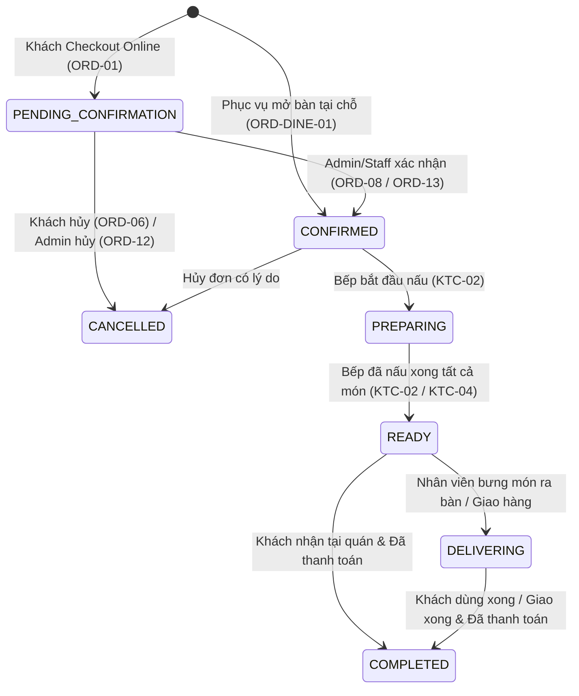
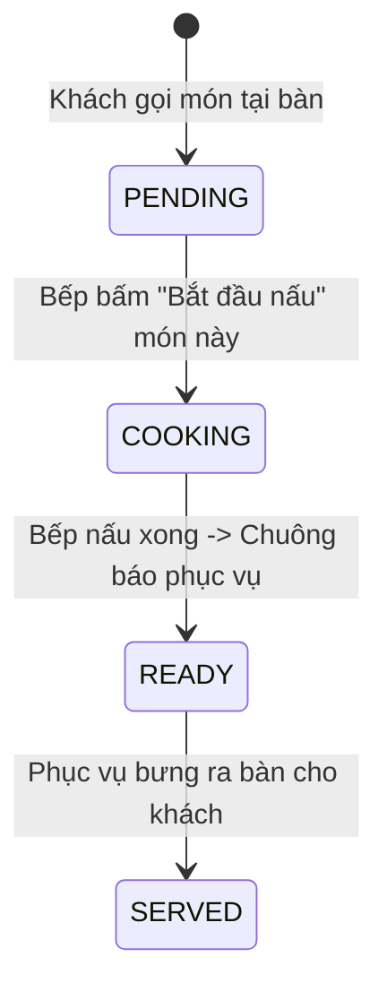

# 📦 MODULE: ORDER – Business Logic & API Spec

> **Vị trí thư mục:** `app/Modules/Order/`  
> **Namespace:** `App\Modules\Order\`  
> **Phiên bản:** 2.0 (Streamlined Edition)

---

## 1. Tổng quan & Trách nhiệm

Module **Order** quản lý toàn bộ quy trình vận hành đơn hàng của nhà hàng, bao gồm cả **Đặt hàng trực tuyến (Delivery/Pickup)** và **Gọi món tại bàn ăn (Dine-in QR Ordering & Kitchen Display System - KDS)**:
- **Checkout Trực tuyến:** Chuyển đổi giỏ hàng thành đơn hàng giao tận nơi hoặc tự đến lấy (`DB::transaction`), chốt snapshot đơn giá tại thời điểm đặt.
- **Gọi món tại bàn (Dine-in):** Phục vụ mở bàn tạo đơn gắn với `BAN_AN`, cấp mã QR bàn; khách ngồi tại bàn quét QR để gọi món trực tiếp và gọi thêm món qua nhiều đợt.
- **Theo dõi tiến độ món Real-time:** Khách hàng theo dõi chi tiết trạng thái từng món trong bếp trực tiếp trên điện thoại của mình.
- **Màn hình Bếp (Kitchen Display System - KDS):** Bếp quản lý danh sách đơn theo bàn, theo dõi và cập nhật trạng thái từng món (`PENDING` $\rightarrow$ `COOKING` $\rightarrow$ `READY` $\rightarrow$ `SERVED`) tránh nghẽn bếp khi đơn có nhiều món.
- **Chống Race Condition:** Áp dụng Redis Distributed Lock `lock:order:checkout:{accountId}` trong 10 giây chống double-click.
- **FSM Trạng thái & Đồng bộ Thanh toán:** Điều hành máy trạng thái đơn hàng và trạng thái từng món, hỗ trợ thanh toán trả trước (Online) hoặc trả sau tại quầy (Dine-in).

---

## 2. Thành phần kỹ thuật

| Thành phần | Lớp / Đường dẫn thực tế | Trách nhiệm |
| :--- | :--- | :--- |
| **Models** | `Order` (`DON_HANG`)<br>`OrderItem` (`CHI_TIET_DON_HANG`) | Model đơn hàng (hỗ trợ `ma_ban`, `loai_don_hang`, `ma_truy_cap_ban`) và Pivot chi tiết món (lưu snapshot `don_gia`, `ghi_chu`, `trang_thai_mon`). |
| **Enums** | `OrderStatus`<br>`OrderItemStatus`<br>`OrderFulfillmentType` | Trạng thái đơn hàng, Trạng thái từng món trong bếp, và Hình thức phục vụ (`DELIVERY`, `PICKUP`, `DINE_IN`). |
| **Services** | `Customer\OrderService`<br>`Admin\OrderService`<br>`Kitchen\KitchenService` | Xử lý checkout online, phục vụ mở bàn, khách gọi món tại bàn, bếp điều phối KDS và đồng bộ thanh toán. |
| **Controllers**| `Customer\OrderController`<br>`Admin\OrderController`<br>`Kitchen\KitchenController` | Tiếp nhận request và trả về chuẩn `ApiResponse`. |
| **Requests**  | `CheckoutOrderRequest`, `CancelOrderRequest`<br>`OpenDineInTableRequest`, `AddDineInItemsRequest`<br>`UpdateOrderItemStatusRequest`, `UpdateOrderStatusRequest` | Kiểm thực dữ liệu checkout, mở bàn, gọi món và chuyển trạng thái bếp. |
| **Resources** | `OrderResource`, `AdminOrderResource`<br>`DineInOpenTableResource`, `DineInTrackingResource`<br>`KitchenOrderResource` | Định dạng dữ liệu đơn hàng, mã QR bàn, tiến độ món cho khách và màn hình KDS cho Bếp. |
| **Routes**    | `app/Modules/Order/Routes/api.php` | Định tuyến `/api/v1/customer/orders/*`, `/api/v1/admin/orders/*` và `/api/v1/kitchen/*`. |

---

## 3. Máy Trạng Thái Đơn Hàng (Order FSM) & Domain Rules

### 3.1. Sơ Đồ Chuyển Đổi Trạng Thái Đơn Hàng Tổng Thể


### 3.2. Máy Trạng Thái Từng Món Trong Bếp (`OrderItemStatus`)


### 3.3. Quy Tắc Đồng Bộ Trạng Thái Giữa Bếp & Đơn Hàng
- Khi có ít nhất 1 món chuyển sang `COOKING`: Đơn hàng tự động cập nhật sang `PREPARING` (Đang chuẩn bị).
- Khi **toàn bộ** các món trong đơn chuyển sang `READY` hoặc `SERVED`: Đơn hàng tự động cập nhật sang `READY` (Món đã sẵn sàng).
- Khi **toàn bộ** các món trong đơn đã được bưng ra (`SERVED`): Đơn hàng chuyển sang `DELIVERING` (Đang phục vụ tại bàn).
- Khi khách thanh toán thành công tại quầy: Đơn hàng chuyển sang `COMPLETED`, đồng thời giải phóng bàn ăn về `AVAILABLE`.

### 3.4. Quy Tắc Gọi Món Tại Bàn Qua Mã QR (Dine-in Token Security)
- Mỗi phiên mở bàn có 1 mã truy cập ngẫu nhiên duy nhất `ma_truy_cap_ban` (Token).
- Khách quét mã QR trên bàn sẽ nhận được URL kèm token này.
- Khi khách gửi món (`ORD-DINE-02`) hoặc xem tiến độ (`ORD-DINE-03`), hệ thống kiểm tra token hợp lệ với `orderId` và đảm bảo bàn đang ở trạng thái `OCCUPIED`.
- Khách có thể gửi gọi món thành nhiều đợt (Round 1 khai vị, Round 2 món chính, Round 3 nước uống), hệ thống tự động cộng dồn vào đơn của bàn và cập nhật tổng tiền `tong_tien`.

### 3.5. Quy Tắc Khóa Phân Tán Redis (Distributed Lock)
- Key: `lock:order:checkout:{accountId}`, TTL 10 giây.
- Sử dụng callback `Cache::lock($key, 10)->block(5, function () { ... })` đảm bảo luôn giải phóng lock trong mọi tình huống, tránh Deadlock nếu phát sinh lỗi.
- Người dùng bấm đúp sẽ nhận lỗi `429 Too Many Requests`.

---

## 4. Schemas Dữ Liệu Chuẩn Dành Cho Frontend

### Schema 4.1: Đơn Hàng Khách Hàng (`Customer\OrderResource`)
```json
{
  "orderId": 105,
  "orderDate": "2026-11-10T12:30:00",
  "status": "PENDING_CONFIRMATION",
  "totalAmount": 170000,
  "shippingAddress": "[DELIVERY] Nguyễn Văn A - 0901234567 | 123 Lê Duẩn, Q.1",
  "payment": {
    "paymentId": 50,
    "amount": 170000,
    "paymentMethod": "CASH",
    "status": "UNPAID",
    "transactionCode": null
  },
  "items": [
    {
      "dishId": 5,
      "dishName": "Gỏi ngó sen tôm thịt",
      "quantity": 2,
      "unitPrice": 85000,
      "subTotal": 170000,
      "note": "Không hành",
      "itemStatus": "PENDING"
    }
  ]
}
```
*(Ghi chú: `AdminOrderResource` bổ sung thêm `fulfillmentType`, `tableId`, `tableName`, `accountId`, `customerName`, `customerPhone`, `recipientName`, `recipientPhone`.)*

### Schema 4.2: Phục Vụ Mở Bàn Tại Chỗ (`DineInOpenTableResource`)
```json
{
  "orderId": 106,
  "tableId": 1,
  "tableName": "Bàn T01",
  "qrToken": "9a8b7c6d5e4f3a2b1c0d9e8f7a6b5c4d",
  "qrUrl": "http://localhost:5173/dine-in/9a8b7c6d5e4f3a2b1c0d9e8f7a6b5c4d",
  "status": "CONFIRMED",
  "orderDate": "2026-11-17T09:45:00"
}
```
*(Lưu ý: `qrUrl` lấy domain từ biến môi trường `FRONTEND_URL`, fallback về `config('app.url')`.)*

### Schema 4.3: Khách Hàng Theo Dõi Tiến Độ Món Ăn Tại Bàn Real-time (`DineInTrackingResource`)
```json
{
  "orderId": 106,
  "tableId": 1,
  "tableName": "Bàn T01",
  "status": "PREPARING",
  "statusName": "Đang chuẩn bị",
  "totalAmount": 450000,
  "items": [
    {
      "dishId": 1,
      "dishName": "Gỏi ngó sen tôm thịt",
      "imageUrl": "/img/goi-ngo-sen.jpg",
      "quantity": 1,
      "unitPrice": 85000,
      "subTotal": 85000,
      "note": "Không hành",
      "itemStatus": "READY",
      "itemStatusName": "Đã sẵn sàng"
    },
    {
      "dishId": 5,
      "dishName": "Bò lúc lắc",
      "imageUrl": "/img/bo-luc-lac.jpg",
      "quantity": 2,
      "unitPrice": 120000,
      "subTotal": 240000,
      "note": "Ít cay",
      "itemStatus": "COOKING",
      "itemStatusName": "Đang nấu"
    }
  ]
}
```

### Schema 4.4: Màn Hình Bếp KDS Quản Lý Đơn & Món (`KitchenOrderResource`)
```json
{
  "orderId": 106,
  "orderDate": "2026-11-17T09:45:00",
  "orderTime": "2026-11-17T09:45:00",
  "waitingMinutes": 12,
  "fulfillmentType": "DINE_IN",
  "tableId": 1,
  "tableName": "Bàn T01",
  "status": "PREPARING",
  "orderStatus": "PREPARING",
  "items": [
    {
      "dishId": 1,
      "dishName": "Gỏi ngó sen tôm thịt",
      "quantity": 1,
      "note": "Không hành",
      "itemStatus": "READY",
      "itemStatusName": "Đã sẵn sàng"
    },
    {
      "dishId": 5,
      "dishName": "Bò lúc lắc",
      "quantity": 2,
      "note": "Ít cay",
      "itemStatus": "COOKING",
      "itemStatusName": "Đang nấu"
    }
  ]
}
```

---

## 5. Bảng Tổng Hợp Endpoints Đơn Hàng & Bếp (16 APIs chính + 5 aliases)

| Mã API | Method | Endpoint URL | Phân quyền | Body / Query Request | Response Payload | Mã HTTP |
| :---: | :---: | :--- | :---: | :--- | :--- | :---: |
| `ORD-01` | `POST` | `/api/v1/customer/orders/checkout` | `CUSTOMER` | `{ "fulfillmentType", "recipientName", "recipientPhone", "shippingAddress"?, "orderNote"?, "paymentMethod" }` | `201`: `OrderResource` *(Chi tiết tại Mục 6)* | `201 / 400 / 429` |
| `ORD-04` | `GET` | `/api/v1/customer/orders` | `CUSTOMER` | Query: `page`, `perPage`, `status` | Paginated `[OrderResource]` | `200` |
| `ORD-05` | `GET` | `/api/v1/customer/orders/{orderId}` | `CUSTOMER` | *(Không)* | `OrderResource` chi tiết | `200 / 404` |
| `ORD-06` | `POST\|PUT` | `/api/v1/customer/orders/{orderId}/cancel` | `CUSTOMER` | `{ "cancelReason"?: string }` | `{ "orderId", "status": "CANCELLED" }` | `200 / 409` |
| `ORD-07` | `GET` | `/api/v1/admin/orders` | `ADMIN,STAFF` | Query: `page`, `perPage`, `status`, `date`, `fulfillmentType`, `search` | Paginated `[AdminOrderResource]` | `200` |
| `ORD-07B` | `GET` | `/api/v1/admin/orders/{orderId}` | `ADMIN,STAFF` | *(Không)* | `AdminOrderResource` chi tiết | `200 / 404` |
| `ORD-08` | `PATCH`| `/api/v1/admin/orders/{orderId}/status` | `ADMIN,STAFF` | `{ "targetStatus": string }` | `{ "orderId", "previousStatus", "currentStatus" }` *(Chi tiết FSM tại Mục 6)* | `200 / 400` |
| `ORD-12` | `POST\|PUT` | `/api/v1/admin/orders/{orderId}/cancel` | `ADMIN,STAFF` | `{ "cancelReason"?: string }` | `{ "orderId", "status": "CANCELLED" }` + giải phóng bàn (nếu là Dine-in) | `200 / 400 / 404` |
| `ORD-13` | `POST`| `/api/v1/admin/orders/{orderId}/confirm-payment` | `ADMIN,STAFF` | `{ "note"?: string }` | `{ "orderId", "paymentId", "paymentStatus": "PAID", "orderStatus", "amount" }` | `200 / 404` |
| `ORD-DINE-01`| `POST`| `/api/v1/admin/orders/dine-in/open-table` | `ADMIN,STAFF` | `{ "tableId": int, "guestCount"?: int, "note"?: string }` | `DineInOpenTableResource` (Schema 4.2 kèm mã QR) | `201 / 400 / 404` |
| `ORD-DINE-02`| `POST`| `/api/v1/dine-in/{token}/items` *(FE aliases: `POST /customer/orders/dine-in/{orderId}/items`, `POST /orders/dine-in/{orderId}/items`)* | Public *(kèm token)* | `{ "token"?, "items": [{ "dishId", "quantity", "note"? }] }` | `DineInTrackingResource` sau khi thêm món vào bếp | `200 / 400 / 403` |
| `ORD-DINE-03`| `GET` | `/api/v1/dine-in/{token}/tracking` *(FE aliases: `GET /customer/orders/dine-in/{orderId}`, `GET /orders/dine-in/{orderId}`)* | Public *(kèm token)* | Query: `token` *(với alias theo `orderId`)* | `DineInTrackingResource` (Theo dõi tiến độ món) | `200 / 403 / 404` |
| `KTC-01` | `GET` | `/api/v1/kitchen/orders` | `ADMIN,STAFF` | *(Không)* | Danh sách `[KitchenOrderResource]` đang `CONFIRMED`/`PREPARING`/`READY` | `200` |
| `KTC-02` | `PUT\|PATCH`| `/api/v1/kitchen/orders/{orderId}/items/{dishId}/status` *(FE alias: `/kitchen/orders/{orderId}/dishes/{dishId}/status`)* | `ADMIN,STAFF` | `{ "status": "PENDING|COOKING|READY|SERVED" }` | `{ "orderId", "dishId", "itemStatus", "itemStatusName", "orderStatus" }` | `200 / 400 / 404` |
| `KTC-03` | `PUT\|PATCH`| `/api/v1/kitchen/orders/{orderId}/items/{dishId}/serve` | `ADMIN,STAFF` | *(Không)* | Đánh dấu món đã bưng ra bàn (`SERVED`) & tự sync đơn | `200 / 404` |
| `KTC-04` | `PUT\|PATCH`| `/api/v1/kitchen/orders/{orderId}/status` | `ADMIN,STAFF` | `{ "targetStatus": "PREPARING|READY" }` | Cập nhật nhanh trạng thái tổng cả đơn qua FSM | `200 / 400 / 404` |

---

## 6. Use Cases Nghiệp Vụ Phức Tạp (Complex Use Cases)

### UC ORD-DINE-01: Phục Vụ Mở Bàn Ăn Tại Chỗ (Dine-in Open Table)
- **Actor:** Phục vụ / Thu ngân (`ADMIN, STAFF`).
- **Endpoint:** `POST /api/v1/admin/orders/dine-in/open-table`
- **Validation:** `tableId`: `required|integer|exists:BAN_AN,ma_ban`.
- **Luồng thực thi:**
  1. Kiểm tra trạng thái bàn ăn: nếu đang `MAINTENANCE` ném lỗi `400 Bad Request`.
  2. Kiểm tra tính idempotent: nếu bàn đã có đơn Dine-in đang hoạt động (`trang_thai NOT IN (COMPLETED, CANCELLED)`), trả lại luôn đơn đó cùng `qrToken`.
  3. Cập nhật `BAN_AN.trang_thai = OCCUPIED` (`Đang phục vụ`).
  4. Sinh mã `qrToken` ngẫu nhiên bảo mật (32 ký tự hex).
  5. Tạo bản ghi `DON_HANG` với `loai_don_hang = OrderFulfillmentType::DINE_IN`, `ma_ban = $tableId`, `ma_truy_cap_ban = $qrToken`, `trang_thai = CONFIRMED`, kèm bản ghi `THANH_TOAN` khởi tạo (`CASH`, `UNPAID`, `so_tien = 0`).
  6. Trả về `DineInOpenTableResource` (HTTP `201`) chứa `qrToken` và `qrUrl` để phục vụ đưa cho khách tại bàn quét.

---

### UC ORD-DINE-02: Khách Hàng Gọi Món Qua Mã QR Tại Bàn
- **Actor:** Khách hàng tại bàn (`CUSTOMER` hoặc Public quét QR).
- **Endpoint:** `POST /api/v1/dine-in/{token}/items` *(hoặc FE alias `POST /api/v1/customer/orders/dine-in/{orderId}/items`)*
- **Validation:**
  - `items`: `required|array|min:1`
  - `items.*.dishId`: `required|integer|exists:MON_AN,ma_mon_an`
  - `items.*.quantity`: `required|integer|min:1`
  - `items.*.note`: `nullable|string|max:255`
- **Luồng thực thi:**
  1. Xác thực `token` khớp với `DON_HANG.ma_truy_cap_ban`. Nếu sai ném `403 Forbidden`.
  2. Kiểm tra đơn bàn vẫn đang mở (không ở trạng thái `COMPLETED` hay `CANCELLED`).
  3. Duyệt từng món, kiểm tra món còn mở bán (`da_xoa = false`, `hien_thi = true`, `con_ban = true`).
  4. Lưu hoặc cộng dồn chi tiết món vào `CHI_TIET_DON_HANG` kèm snapshot đơn giá, `ghi_chu`, và gán `trang_thai_mon = PENDING`.
  5. Tính lại `DON_HANG.tong_tien` và đồng bộ `THANH_TOAN.so_tien`.
  6. Trả về `DineInTrackingResource` (`200 OK`).

---

### UC KTC-02: Bếp Cập Nhật Tiến Độ Món Ăn Lẻ (Kitchen Item Tracking)
- **Actor:** Đầu bếp / Nhân viên bếp (`ADMIN, STAFF`).
- **Endpoint:** `PUT|PATCH /api/v1/kitchen/orders/{orderId}/items/{dishId}/status` *(hoặc alias `/dishes/{dishId}/status`)*
- **Validation:** `status`: `required|string|in:PENDING,COOKING,READY,SERVED`.
- **Luồng thực thi:**
  1. Tìm chi tiết món trong `CHI_TIET_DON_HANG` theo `(ma_don_hang, ma_mon_an)`.
  2. Cập nhật `trang_thai_mon = $status`.
  3. Tự động kiểm tra và đồng bộ trạng thái chung của `DON_HANG`:
     - Nếu tất cả món đều `SERVED` $\rightarrow$ Đơn chuyển sang `DELIVERING` (Đang phục vụ tại bàn).
     - Ngược lại, nếu tất cả món đều `READY` hoặc `SERVED` $\rightarrow$ Đơn chuyển sang `READY`.
     - Ngược lại, nếu có món đang `COOKING` $\rightarrow$ Đơn chuyển sang `PREPARING`.
  4. Trả về thông tin món và trạng thái đơn hàng sau khi đồng bộ.

---

### UC ORD-01: Checkout Đặt Hàng Từ Giỏ Hàng (Redis Lock + Transaction)
- **Actor:** Khách hàng (`CUSTOMER`).
- **Endpoint:** `POST /api/v1/customer/orders/checkout`
- **Validation:**
  - `fulfillmentType`: `required|in:DELIVERY,PICKUP`
  - `recipientName`: `required|string|max:100`
  - `recipientPhone`: `required|regex:/^(0|\+84)[0-9]{9,10}$/`
  - `shippingAddress`: `required_if:fulfillmentType,DELIVERY|string`
  - `paymentMethod`: `required|in:CASH,BANK_TRANSFER_QR`
- **Luồng thực thi 7 bước (Bọc trong `Cache::lock` & `DB::transaction`):**
  1. **Khóa Redis:** Khóa `lock:order:checkout:{accountId}` trong 10s. Nếu đang bận ném `429 Too Many Requests`.
  2. **Khóa bản ghi Giỏ:** `Cart::where('ma_tai_khoan', $id)->lockForUpdate()->first()`. Nếu giỏ rỗng ném `400 Bad Request`.
  3. **Kiểm tra trạng thái món & Snapshot giá:** Duyệt qua các món trong giỏ. Nếu món bị xóa/hết hàng ném `400 Bad Request`. Chốt cứng snapshot `don_gia = $dish->gia_tien`.
  4. **Tạo Đơn Hàng:** Tạo bản ghi `DON_HANG` với trạng thái `PENDING_CONFIRMATION` và địa chỉ giao hàng chuẩn hóa.
  5. **Lưu Chi Tiết Món:** Gọi `$order->dishes()->attach($pivotData)` lưu `so_luong` và `don_gia`.
  6. **Khởi tạo Thanh toán:** Tạo bản ghi `THANH_TOAN` tương ứng với trạng thái `UNPAID`.
  7. **Làm rỗng giỏ:** Gọi `$cart->dishes()->detach()`.
- **Response `201 Created`:** `OrderResource` (Schema 4.1).

---

### UC ORD-08: Cập Nhật Trạng Thái Quy Trình Đơn Hàng (Admin/Staff)
- **Actor:** Quản trị viên / Nhân viên (`ADMIN, STAFF`).
- **Endpoint:** `PATCH /api/v1/admin/orders/{orderId}/status`
- **Validation:** `targetStatus`: `required|string|in:CONFIRMED,PREPARING,READY,DELIVERING,COMPLETED,CANCELLED`.
- **Luồng thực thi:**
  1. Kiểm tra trạng thái hiện tại đối chiếu với `OrderStatus::canTransitionTo()`. Nếu bước chuyển không hợp lệ ném `400 Bad Request`.
  2. Nếu chuyển sang `COMPLETED`:
     - Nếu `phuong_thuc === 'Tiền mặt'` hoặc đơn tại bàn (`ma_ban != null`): tự động cập nhật `Payment.trang_thai = PAID`.
     - Nếu `phuong_thuc === 'Chuyển khoản'` (online) mà `Payment.trang_thai === UNPAID`: ném `400 Bad Request` (*"Đơn hàng chuyển khoản QR chưa được xác nhận thanh toán thành công"*).
  3. Nếu đơn có gắn `ma_ban` và chuyển sang `COMPLETED` hoặc `CANCELLED`: tự động giải phóng bàn ăn về `AVAILABLE` và đồng bộ phiếu đặt bàn `OCCUPIED` tương ứng.
  4. Trả về `{ "orderId", "previousStatus", "currentStatus" }`.
